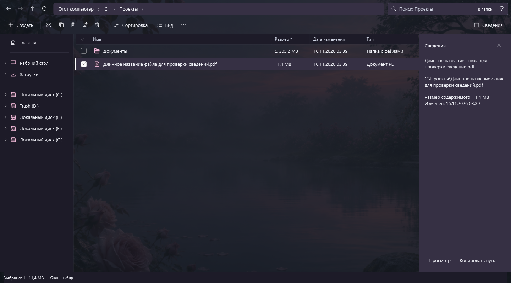
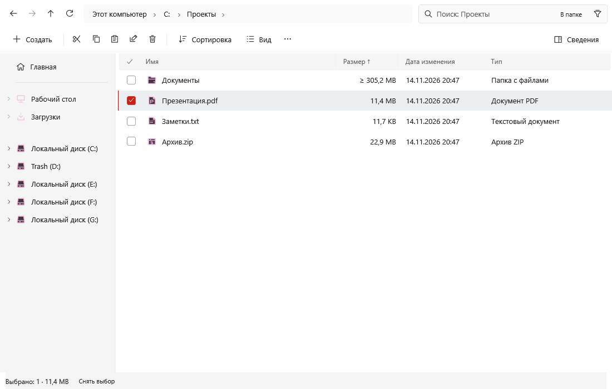

# Seekr

**Твои файлы. Твой стиль.** Файловый менеджер с открытым исходным кодом для Windows x64: быстрый поиск, размеры папок, вкладки, две панели и свои оформления.

**[Скачать Seekr 1.0.6](https://github.com/Kaban425/Seekr-Feedback/releases/download/v1.0.6/Seekr-1.0.6-Setup.exe)** · [Все файлы выпуска](https://github.com/Kaban425/Seekr-Feedback/releases/tag/v1.0.6) · [Исходный код](https://github.com/Kaban425/Seekr) · [Ошибки и предложения](https://github.com/Kaban425/Seekr-Feedback/issues/new/choose)

Версия **1.0.6, сборка 7**. Ранний открытый выпуск; ограничения перечислены ниже.

## Установка

1. Скачайте Setup.exe и закройте запущенный Seekr, если обновляете программу.
2. Выберите папку установки и создание ярлыка на рабочем столе.
3. Нажмите «Открыть Seekr». Версия и сборка указаны в настройках.

Установщик включает .NET и работает без интернета. Выпуск **не подписан сертификатом издателя**: Windows может показывать предупреждение SmartScreen. Не отключайте защиту системы; скачивайте файлы по ссылкам этого репозитория и проверяйте SHA-256. Контрольная сумма подтверждает совпадение файла, но не гарантирует его безопасность.

| Файл | Для чего |
|---|---|
| [Setup.exe](https://github.com/Kaban425/Seekr-Feedback/releases/download/v1.0.6/Seekr-1.0.6-Setup.exe) | Установка и обновление с выбором папки и ярлыка. |
| [MSI](https://github.com/Kaban425/Seekr-Feedback/releases/download/v1.0.6/Seekr-1.0.6-win-x64.msi) | Альтернатива Setup.exe для той же программы. |
| [ZIP](https://github.com/Kaban425/Seekr-Feedback/releases/download/v1.0.6/Seekr-1.0.6-win-x64.zip) | Распакуйте весь архив и запустите Seekr.App.exe. |
| [Манифест SHA-256](https://github.com/Kaban425/Seekr-Feedback/releases/download/v1.0.6/release-manifest.json) | Версия, номер сборки и контрольные суммы файлов. |

Достаточно одного установщика. Архивы **Source code** внизу страницы выпуска содержат файлы репозитория, а не готовую программу.

## Что умеет Seekr

- Поиск по имени, расширению, размеру и дате; сохранённые поиски.
- Размеры папок и карта места; свободное место дисков на главной.
- Вкладки, две панели, копирование, перемещение и пакетное переименование.
- Компактная панель операций, подробная очередь, ошибки и повтор.
- Предпросмотр файлов, поиск дубликатов и кандидатов на очистку.
- Темы, свои обои, акценты, значки, масштаб и редактируемая боковая панель.
- Восстановление вкладок и периодическое сохранение сессии.

Настройки применяются сразу. Повторное нажатие кнопки настроек восстанавливает свёрнутое или поднимает уже открытое окно над Seekr.

## Полезные клавиши

| Действие | Клавиши |
|---|---|
| Поиск / адрес | Ctrl+F / Ctrl+L |
| Новая вкладка / закрыть вкладку | Ctrl+T / Ctrl+W |
| Копировать / вырезать / вставить | Ctrl+C / Ctrl+X / Ctrl+V |
| Переименовать / удалить | F2 / Delete |
| Отменить поддерживаемую операцию | Ctrl+Z |
| Две панели / фокус между панелями | Ctrl+Shift+D / F6 |
| Предпросмотр / поиск команд | Пробел / Ctrl+K |
| История буфера файлов | Ctrl+Shift+V |

## Ограничения

- Windows x64. Служба индексации необязательна; её установка требует прав администратора. Просмотр папок работает без неё.
- Поиск содержимого в интерфейсе отключён. PDF-предпросмотр требует WebView2 Runtime.
- Размеры папок могут быть неполными: знак ≥ отмечает доступную часть. Размер содержимого не равен гарантированно освобождаемому месту.
- Ctrl+Z поддерживает переименование и перемещение без замены на одном диске, при наличии снимка содержимого до 64 МБ. Он не отменяет удаление, замену файлов и завершение процессов. Междисковое и частичное перемещение возвращаются вручную.
- Отмена операции не откатывает автоматически уже обработанные файлы. Проверяйте результат в очереди.
- Поиск дубликатов и очистка предлагают кандидатов для ручной проверки. Прозрачность рабочего стола не используется.
- Подробности: [ограничения](https://github.com/Kaban425/Seekr/blob/main/docs/LIMITATIONS.md). Возможны ошибки; проверяйте операции на тестовых данных и сохраняйте резервные копии важных файлов.

## Ошибки и предложения

Откройте [новое обращение](https://github.com/Kaban425/Seekr-Feedback/issues/new/choose), укажите версию, Windows, шаги и ожидаемый результат. Нужен аккаунт GitHub.

В программе форма доступна через «… → Сообщить об ошибке», настройки или Ctrl+K. Она открывает черновик; отправка происходит только после вашего подтверждения. Безопасную диагностику можно экспортировать отдельно. Перед публикацией проверьте вложения: не прикладывайте личные документы, пароли, токены и необработанные локальные отчёты.

## Обновление и удаление

Для обновления закройте Seekr и запустите установщик новой версии. Настройки и вкладки сохраняются. Удаление: Параметры Windows → Приложения → Seekr → Удалить. Отдельно установленную службу можно удалить через окно состояния поиска. Настройки и отчёты остаются в `%LocalAppData%\Seekr`.

[История изменений](CHANGELOG.md) · [Лицензия MIT](LICENSE) · [Разработка](https://github.com/Kaban425/Seekr)
